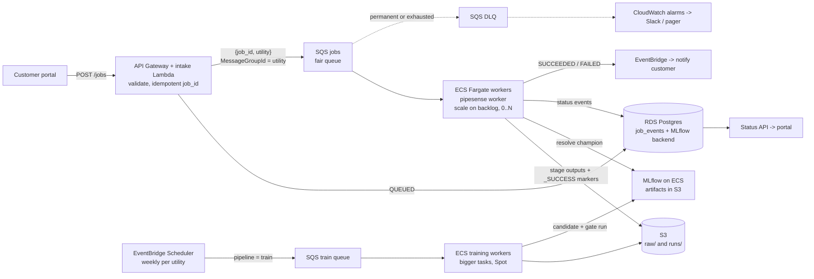

# DESIGN: PipeSense on AWS, event-driven, for hundreds of utilities

**Goal.** Any of roughly 300 utilities can request an analysis at any time. A job takes 2 minutes to several
hours. A team of two runs it, and live customers move over without an outage. The local
`--profile prod` compose stack is a working miniature of this design: same image, same queue
semantics, same status model.

## How a job is triggered and executed

1. The portal calls `POST /jobs`. An intake Lambda checks the request (known utility, raw export present in
   `s3://…/raw/<utility>/`), records `QUEUED` and sends `{job_id, utility}` to SQS. `job_id` is the
   idempotency key: a double-submitted request maps to the same run directory and the same stage markers.
2. The message's `MessageGroupId` is the utility, so SQS **fair queues** stop one utility submitting 200
   jobs from starving the others. No consumer change is needed.
3. Workers are an ECS service on Fargate running `pipesense worker`, the same container that runs
   locally. It scales on queue backlog per task, down to zero when idle. Each worker runs one job
   at a time: `prepare` then `predict`, each writing to `runs/<utility>/<job_id>/<stage>/` and committing
   with a `_SUCCESS.json` marker. A heartbeat extends message visibility, so multi-hour jobs are not
   redelivered while they run (SQS allows up to 12 h).
4. Training runs on a separate queue and service, so it never competes with customer jobs. A schedule
   (or a new labelled export) enqueues `pipeline=train`. The candidate goes through the promotion gate,
   and only `PROMOTED` moves the `champion` alias. Score jobs resolve the alias once and stamp the version
   on every prediction.

**Why not Lambda, Step Functions + Batch, or Airflow?** Lambda stops at 15 minutes. Step Functions +
Batch is the strongest alternative: per-stage containers, per-job sizing and EC2 Spot for very long jobs.
It adds two services and job definitions to maintain, and the runner's markers already provide
per-stage resume. Because every stage is also a plain CLI call (`pipesense stage predict …`) with
meaningful exit codes (0 / 2 permanent / 75 retry), moving to Batch later is configuration, not a
rewrite. Batch `retryStrategy.evaluateOnExit` maps directly onto those exit codes. MWAA/Airflow and EKS
cost hundreds of dollars a month before the first job, and need care that a two-person team should
spend elsewhere.

## When things fail

| Failure | What happens |
|---|---|
| Bad input (missing column, >20% invalid rows, unknown materials) | Exit 2 → `FAILED` at once, message to the DLQ with the reason, customer notified. Retrying cannot fix data. |
| Transient (S3 throttling, MLflow 5xx, Spot reclaim, OOM-kill, bug) | Message left on the queue with exponential visibility backoff. The retry **skips finished stages** (markers). After 3 attempts → `DEAD_LETTERED`. |
| Worker or AZ dies mid-job | Message is never deleted. SQS redelivers after the visibility timeout. The SQS redrive policy is the backstop for crash loops. |
| A bad image reaches prod | ECS rolls back to the previous task definition (by digest). Affected jobs are found by the `image_tag` in their manifests and re-run with `--force`. |
| A bad model reaches prod | `pipesense promote --version <previous>` is an audited rollback, effective for the next job. |
| Status DB down | Jobs continue. Status writes are best-effort, and SQS plus S3 markers are the source of truth. |

Alarms: DLQ depth > 0, oldest message age > 30 min, failure rate per utility, worker restart loop,
RDS storage and CPU. Once the cause is fixed, the runbook is "redrive the DLQ" (`StartMessageMoveTask`).
Redrive is safe because of the markers.

## Monitoring the model

Every scoring job computes PSI per feature between the scored inventory and the champion's training
data, using a profile stored with the model, and writes it to `manifest.json`. A feature above 0.2 logs a
warning with `job_id` and `utility`. A CloudWatch metric filter turns it into a per-utility count for the daily
digest. A feature that keeps drifting triggers a retrain, and the candidate still has to pass the gate.
Drift never fails a customer job.

## Migrating without disrupting live customers

0. **Today:** hotfix the VM scripts (strict mode, a correct `FAILED` status), already in the git history.
1. **Shadow:** the VM job watcher keeps serving. For each job it also enqueues the same request to AWS,
   which writes to S3 but delivers nothing. Compare per utility: top-decile overlap, rank correlation
   and runtime. Expect differences, because the old system retrains on every job and scores pipes it
   trained on.
2. **Route per utility:** a routing table (`utility → vm | aws`) sits in the watcher. Pilot with
   Fairport, then move in batches. The new system also writes the legacy `status.json` and output path,
   so the NFS monitor and customer delivery keep working. Rollback means flipping one row.
3. **Decommission:** once every utility is on AWS for 30 days, retire the VM and NFS.

Each utility's first champion is trained and gated (it must beat the age rule) before that utility is
switched.

## Operating it as two people

- **Only managed services:** SQS, ECS Fargate, RDS, S3, ECR, Lambda. No cluster to patch.
  Terraform defines staging and prod, which differ only in the env file, as in local compose.
- **Releases:** CI runs the `test` image and pushes an immutable ECR tag (`<git-sha>`, scan on push).
  The same digest goes to staging, then prod. Model promotions go through the gate, with a manual,
  audited override.
- **Low-noise on-call:** page only on customer impact (queue age, DLQ, failure spike). Everything else
  goes to a daily Slack digest. Structured JSON logs carry `job_id`, `utility` and `stage`, so one
  CloudWatch Logs Insights query answers "what happened to job X".
- **Security:** task roles, not keys. Per-utility S3 prefixes. SSE-KMS. Private subnets with an S3
  gateway endpoint. Secrets in Secrets Manager.

## Rough cost (us-east-1 list prices, per month)

Assumptions: 300 utilities, 1,000 score jobs/day averaging 10 min on 1 vCPU / 4 GB, and weekly training
per utility of 1 h on 4 vCPU / 16 GB. Fargate is $0.0405 per vCPU-hour and $0.0044 per GB-hour.

| Item | On-demand | With Fargate Spot |
|---|---|---|
| Score jobs: 5,000 task-hours × $0.058 | ~$290 | ~$100 |
| Training: 1,300 task-hours × $0.233 | ~$300 | ~$100 |
| RDS Postgres (small, Multi-AZ) + storage | ~$110 | ~$110 |
| MLflow on Fargate + internal ALB | ~$40 | ~$40 |
| NAT gateway, CloudWatch Logs, S3, SQS, Lambda, ECR | ~$110 | ~$110 |
| **Total** | **~$850** | **~$460** |

Compute dominates, so the levers are Spot (a reclaim is safe: the job resumes from markers) and right-sizing
from the per-stage durations recorded in every marker.

**Deliberately left out:** Kubernetes, Airflow, Kafka, multi-region, real-time serving, a feature store,
GPUs and per-customer isolation beyond S3 prefixes and IAM. None is needed for batch scoring at this
scale, and each would cost the team more time than it saves.
