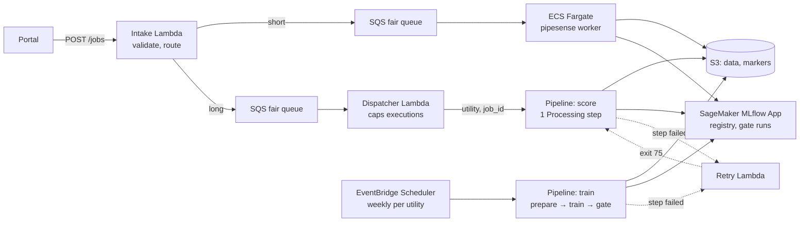

# DESIGN: PipeSense on SageMaker, for hundreds of utilities

**Goal.** ~300 utilities, jobs of 2 minutes to hours at any time, two people, no outage. SageMaker runs training and
long jobs; the local `--profile prod` stack stays a working miniature of the queue and failure semantics.

## How a job is triggered and executed

1. `POST /jobs` → an intake Lambda validates, records `QUEUED` and routes by expected runtime (stage durations in the
   utility's last markers) to one of two SQS **fair queues**: `MessageGroupId` = utility, so one utility's burst cannot
   starve the rest. `job_id` is the idempotency key.
2. **Short jobs:** Fargate workers run `pipesense worker`, as in the miniature. **Long jobs:** a dispatcher Lambda
   starts the `score` pipeline with `utility` and `job_id` as parameters, with a `ClientRequestToken` derived from
   `job_id`, and only below an execution cap, so excess waits in SQS. It is one Processing step (`run score`) so a job
   pays one start-up, not one per stage.
3. **Training:** EventBridge Scheduler starts the `train` pipeline weekly per utility. Its Processing steps run our image
   with arguments only (`stage prepare|train|gate …`), keeping the `pipesense` entrypoint. Only `PROMOTED` moves
   `champion`.
4. **Registry: SageMaker managed MLflow**, client pinned to the server version as AWS requires. Tracking servers stop at
   3.0, which cannot write skops models, so we use an MLflow App (3.10): `mlflow-skinny` 3.10.x instead of 3.16, plus
   `sagemaker-mlflow`. Apps auto-update, so CI checks that client and server versions match.

## SageMaker trade-offs

1. **Start-up.** Each Processing job launches and releases its instances (warm pools are training-only). AWS publishes
   no start-up time, so the pilot measures `CreationTime` → `ProcessingStartTime`. It can exceed a 2-minute job, so
   **short scoring stays on SQS + Fargate (hybrid)**; the threshold comes from that data.
2. **Retries.** Retry policies cover `Step.SERVICE_FAULT`, `Step.THROTTLING` and SageMaker `JOB_INTERNAL_ERROR`,
   `CAPACITY_ERROR` and `RESOURCE_LIMIT`, not our exit codes. `pipesense` writes its error class to
   `/opt/ml/output/message` (the job's `ExitMessage`). A Lambda on the step-failed event re-starts the execution on
   exit 75 (3 attempts) and records exit 2 as `FAILED`. Markers make a re-start cost start-ups, not recomputation.
3. **Caching off, markers kept.** Step caching keys on the job request (`AppSpecification`, `Environment`,
   `ProcessingInputs`), not the S3 content our stages read. Markers fingerprint content.
4. **Quotas** (defaults): 4 instances across all processing jobs, 20 concurrent pipeline executions (adjustable),
   `CreateProcessingJob` 1/s (fixed). Raised before the pilot; the cap queues the excess.

## When things fail

| Failure | What happens |
|---|---|
| Bad input | Missing column, implausible units, invalid rows: exit 2 → `FAILED` at once, with the reason. |
| Transient | Fargate: re-queued. SageMaker: execution re-started. Finished stages skipped; after 3 attempts `DEAD_LETTERED`. |
| Killed | Fargate (OOM, SIGKILL): next delivery records `PREVIOUS_ATTEMPT_LOST`, past 3 attempts `DEAD_LETTERED`; redrive policy is the backstop. SageMaker: the job ends `Failed`. |
| Rollback | Redeploy the previous digest, or `pipesense promote --version <previous>` (audited). |

Alarms: DLQ depth, oldest message > 30 min, failure rate per utility, ECS task-stopped events with an `OutOfMemory`
reason and failed Processing jobs (EventBridge → alarm). Manifests flag drift (PSI > 0.2).

## Migrating without disrupting live customers

1. **Shadow per utility:** the hotfixed VM keeps serving and also submits each job to the new intake, which delivers
   nothing. Compare top-decile overlap, rank correlation, runtime and start-up.
2. **Route per utility** (`utility → vm | aws`, legacy `status.json` still written): Fairport first, each once its first
   champion passes the gate in managed MLflow. Rollback is one row; the VM goes after 30 days.

## Operating it as two people

Managed services only, in Terraform. CI tests the image and points the task definition and both pipelines at its
`<git-sha>` digest. Page only on customer impact. IAM roles, per-utility S3 prefixes, SSE-KMS.

## Rough cost (approximate)

us-east-1 on-demand (AWS Price List, Oct 2026), start-up excl.; MLflow App: no extra charge. 900 jobs/day of ~5 min,
100 of ~55 min; weekly per utility 1 h training (4 vCPU / 16 GB), ~10 min prepare and gate.

| Item | Basis | $/month |
|---|---|---|
| Short scoring: Fargate, 1 vCPU / 4 GB | 2,250 h × $0.058 | ~$130 |
| Long scoring: Processing, ml.m5.large | 2,750 h × $0.115 | ~$320 |
| Training m5.xlarge; prepare, gate m5.large | 1,300 h × $0.23 + 430 h × $0.115 | ~$350 |
| RDS t4g.small Multi-AZ, 20 GB; NAT gateway | 730 h × $0.11 + 20 GB × $0.23 | ~$85 |
| **Total** + usage (logs, S3, SQS, Lambda, NAT data) | | **~$880** |

**Left out:** Kubernetes, Airflow, Step Functions (Pipelines is the DAG), Kafka, multi-region, endpoints, GPUs.
