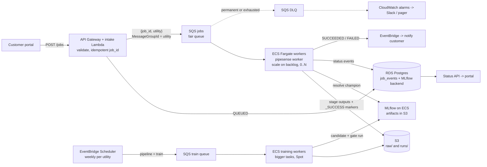

# DESIGN: PipeSense on AWS, event-driven, for hundreds of utilities

**Goal.** About 300 utilities, jobs of 2 minutes to several hours at any time, two people to run it, and no
outage for live customers. The local `--profile prod` stack is a working miniature of this design.

## How a job is triggered and executed

1. The portal calls `POST /jobs`. An intake Lambda checks the request (known utility, raw export in
   `s3://…/raw/<utility>/`), records `QUEUED` and sends `{job_id, utility}` to SQS. `job_id` is the
   idempotency key: a resubmitted job reuses the same run directory and stage markers.
2. `MessageGroupId` is the utility, so SQS **fair queues** stop one utility's burst starving the others.
3. ECS Fargate workers run `pipesense worker`, the local container, scaled on backlog down to zero. Each
   runs one job: `prepare` then `predict`, each committed by a `_SUCCESS.json` marker. A heartbeat extends
   message visibility, so multi-hour jobs are not redelivered (SQS allows 12 h).
4. Training has its own queue and service, fed weekly or by a new labelled export. Only `PROMOTED` moves
   the `champion` alias. Score jobs resolve it once and stamp the version on every row.

**Why not Lambda, Step Functions + Batch, or Airflow?** Lambda stops at 15 minutes. Step Functions + Batch
(per-job sizing, EC2 Spot) adds two services, and the markers already give per-stage resume. Each stage is a
CLI call with exit codes (0 / 2 permanent / 75 retry) that Batch's `evaluateOnExit` maps onto, so moving
later is configuration. MWAA and EKS cost hundreds of dollars a month before the first job.

## When things fail

| Failure | What happens |
|---|---|
| Bad input | Missing column, implausible units, too many invalid rows: exit 2 → `FAILED` at once, DLQ with the reason. |
| Transient error | Throttling, MLflow 5xx: retried with backoff, **skipping finished stages**. After 3 attempts → `DEAD_LETTERED`. |
| Worker killed | OOM, SIGKILL, Spot, AZ loss: the next delivery records `PREVIOUS_ATTEMPT_LOST`, past 3 attempts `DEAD_LETTERED`. The queue's redrive policy is the backstop. |
| Bad image | Redeploy the previous task definition by digest. Re-run jobs whose manifests carry the bad `image_tag`. |
| Bad model | `pipesense promote --version <previous>`: an audited rollback, effective for the next job. |
| Status DB down | Jobs continue. SQS and the S3 markers are the source of truth. |

Alarms: DLQ depth > 0, oldest message > 30 min, failure rate per utility, and ECS task-stopped events with an
`OutOfMemory` reason (EventBridge → alarm). After a fix, redrive the DLQ: the markers make it safe.

**Model monitoring.** Each scoring job writes per-feature PSI against the champion's training data to
`manifest.json` and warns above 0.2. A CloudWatch metric filter counts warnings per utility for the daily
digest. Persistent drift triggers a retrain, which must still pass the gate.

## Migrating without disrupting live customers

0. **Today:** the VM scripts are hotfixed (strict mode, a correct `FAILED` status).
1. **Shadow:** the VM watcher keeps serving and also enqueues each job to AWS, which writes to S3 but
   delivers nothing. Compare per utility: top-decile overlap, rank correlation, runtime.
2. **Route per utility** with a `utility → vm | aws` table in the watcher: Fairport first, then batches,
   each once its first champion passes the gate. AWS also writes the legacy `status.json` and output
   path, so monitoring and delivery keep working. Rollback is one row.
3. **Decommission** the VM and NFS after 30 days with every utility on AWS.

## Operating it as two people

- **Managed services only** (SQS, Fargate, RDS, S3, ECR, Lambda), in Terraform. Staging and prod differ
  only in the env file.
- **Releases:** CI runs the `test` image and pushes an immutable `<git-sha>` ECR tag. The same digest goes
  to staging, then prod.
- **Low-noise on-call:** page only on customer impact (queue age, DLQ, failure spike). JSON logs carry
  `job_id`, `utility` and `stage`, so one query answers "what happened to job X?"
- **Security:** task roles, per-utility S3 prefixes, SSE-KMS, private subnets, Secrets Manager.

## Rough cost (us-east-1 list prices, per month)

Assumes 1,000 score jobs/day of 10 min on 1 vCPU / 4 GB and 1 h of weekly training per utility on
4 vCPU / 16 GB. Spot is safe because a reclaimed job resumes from its markers.

| Item | On-demand | Fargate Spot |
|---|---|---|
| Scoring: 5,000 task-hours × $0.058 | ~$290 | ~$100 |
| Training: 1,300 task-hours × $0.233 | ~$300 | ~$100 |
| RDS Postgres, Multi-AZ | ~$110 | ~$110 |
| MLflow on Fargate + ALB | ~$40 | ~$40 |
| NAT, logs, S3, SQS, Lambda, ECR | ~$110 | ~$110 |
| **Total** | **~$850** | **~$460** |

**Deliberately left out:** Kubernetes, Airflow, Kafka, multi-region, real-time serving, a feature store and
GPUs. None is needed for batch scoring at this scale, and each costs more team time than it saves.
